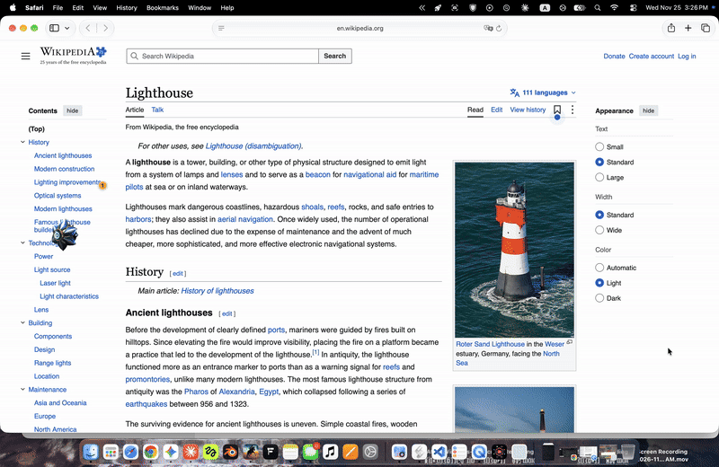
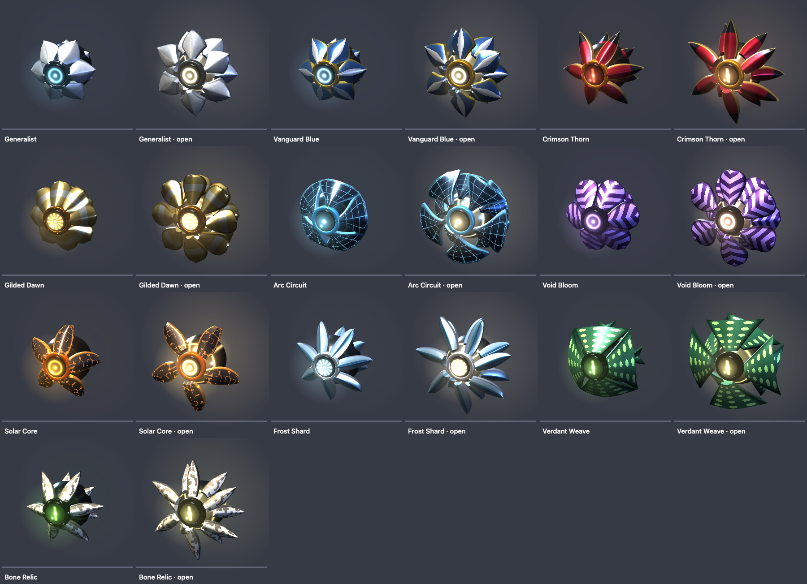
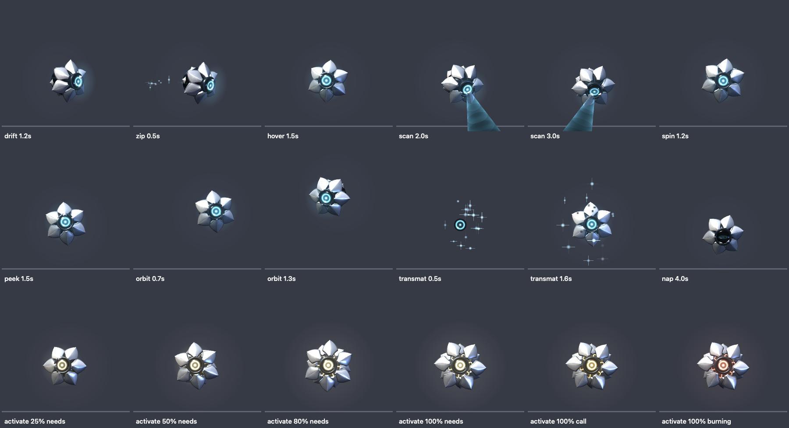

# Ghost: a 3D Dock companion for Claude

A fan tribute to the Destiny Ghost: a small native macOS companion that floats along the top of the Dock. It is a real-time 3D model, built from scratch in Blender by a script in this repo and lit live with SceneKit. No game assets are included or extracted. Not affiliated with Bungie.

What it does:

- **Hovers anywhere on the screen** and picks its own things to do: drift, zip, hover, scan, spin, peek, orbit, transmat (breaks into light and reappears somewhere else) and nap. Drag it anywhere; it stays where you drop it.
- **Scans what is on screen.** It flies beside the front window and sweeps a blue light over its parts: links, buttons, images, headings and text blocks on a web page, or the controls of an app.
- **Watches your pointer.** When the pointer comes within 2 inches of the Ghost (real inches, from the display's size), the eye follows it.
- **Stays out of your way.** It never hovers over the text box you are typing in; if you click into one under it, it moves off.
- **Activates when something waits.** When a Claude session needs you, a decision waits, or an idle session spends tokens, the shell spins one turn as its plates part, the core lights up and the eye flares in the mood's color (amber = your call or needs you, coral = working while you're away). It stays open for 30 s, closes for 2 min, and repeats until the item is cleared.
- **Click the Ghost** to open its panel. The top card is **Shell**:
  - **Change shells.** Tap a tile to wear it (10 built-in tribute shells). Right-click a shell you designed to delete it.
  - **Design a new shell.** Type into *Ask your Ghost for a new shell…* (for example "a shell forged from autumn maple leaves, copper veins, warm amber eye"). Claude writes the shell spec and the Ghost puts it on, with a line of lore. Designed shells are marked ✦.
- **Notifications come through the Ghost.** When a session needs you, the Ghost lights up and shows a card beside it (*Open*, *Snooze 30 min*) instead of a macOS banner. If the Ghost is away, a normal banner is used.
- **Hotkeys** (work from any app):
  - `⌃⌥G` summons the Ghost (it transmats onto the Dock) or sends it away.
  - `⌃⌥⇧G` opens or closes its panel.
- The rest of the panel shows the items waiting on you, sessions working while you're away, the 24 h chart and the Reminders to-do list.

https://github.com/TruSlide/ghost-dock-companion/raw/main/docs/demo.mp4



| Built-in shells (closed and open) | The Ghost's acts and the activation |
|---|---|
|  |  |

## Permissions

- **Accessibility** (System Settings › Privacy & Security › Accessibility › Ghost) lets the Ghost find the focused text box and the parts of the front window. It only reads positions and roles, never text or values. Without it, the Ghost scans whole windows and cannot avoid text boxes. macOS asks on first launch.
- **Notifications** are only used when the Ghost is hidden.

## Claude Code notifications through the Ghost

The Ghost already tells you when a session it watches needs you. To also route Claude Code's own notifications (permission requests, "waiting for input") through it, add a `Notification` hook to `~/.claude/settings.json`:

```json
{
  "hooks": {
    "Notification": [
      { "hooks": [ { "type": "command", "command": "/path/to/Ghost.app/Contents/MacOS/Ghost --say" } ] }
    ]
  }
}
```

Use the path where your `Ghost.app` lives. `Ghost --say` reads the hook's JSON on stdin and passes only the title and message to the running Ghost. You can also call it by hand: `Ghost --say "Title" "Message"`. Then turn off notifications for the Claude app in System Settings › Notifications, so you get one alert, from the Ghost. (Another app's banners cannot be rerouted by Ghost itself; macOS does not allow it.)

## How the shell designer works

- It makes one short call through your local `claude` command: `claude -p --model haiku --tools "" --setting-sources "" --strict-mcp-config --no-session-persistence`. That means no tools, no MCP servers, no hooks or settings, and no saved session. It costs about $0.0003 with Haiku. You can pick Sonnet or Opus in Settings › Shell designer.
- Claude returns a JSON **ShellSpec**: plate count (3-12), shape (`spike`, `facet`, `blade`, `petal`, `crown`, `shard`, `fin`), length, width, gap, back ring, five colors, pattern (`none`, `stripe`, `chevron`, `split`, `band`, `circuit`, `crack`, `dots`, `tips`, `camo`), eye style (`ring`, `slit`, `iris`, `star`), metallic, glow, wear and facet. Every value is clamped before it reaches the 3D model, so a bad answer cannot break it.
- Designed shells are saved in `~/Library/Application Support/Ghost/shells.json`. The shell you are wearing is stored in the app's own defaults (`local.ghostshell`).
- Nothing else uses AI. Watching your sessions is local and read-only.

## The 3D model

The Ghost is an original model in the Ghost's design language: a core sphere with an eye, ringed by shell plates. `blender/build_ghost.py` generates every part with Python (bmesh) in Blender, so it can be rebuilt and changed in code.

- **Parts:** one plate mesh per shape (`spike`, `facet`, `blade`, `petal`, `crown`, `shard`, `fin`), the core, the eye housing, lens and light. They are exported to `Resources/GhostParts.usdz`.
- **Shells are parametric.** At run time the app places the plates in a front and back ring from the ShellSpec (count, length, width, gap) and colors them in a shader (base, accent, trim, pattern, metallic, wear, glow). Every built-in or designed shell uses the same parts.
- **Acts:** idle, activate, scan, spin, transmat and nap are posed live; the Blender file also holds reference actions for each.

Rebuild the parts (needs Blender 4.2 or later):

```bash
/Applications/Blender.app/Contents/MacOS/Blender -b --factory-startup -P blender/build_ghost.py -- --render
```

`--render` also writes preview PNGs to `blender/renders/`.

## Build and run

Needs macOS 26 or later and Swift 6.2. It is a Swift package with no Xcode project.

```bash
./build.sh     # swift build, app icon, bundle Ghost.app with GhostParts.usdz, code-sign
./launch.sh    # restart the app
```

`build.sh` signs ad-hoc by default. Set `GHOST_SIGN_ID` to one of your own certificates so macOS keeps the Accessibility and notification permissions across rebuilds. A stable identity keeps the macOS notification and Reminders permissions across rebuilds.

Checks and test hooks:

- `.build/release/Ghost --sheet docs/sheets` renders the contact sheets above.
- `.build/release/Ghost --design "…"` prints one designed spec and renders it to a temporary PNG.
- `.build/release/Ghost --dump` prints one session scan.
- `.build/release/Ghost --say "Title" "Message"` shows a message through the running Ghost.
- `swift tools/toggle.swift` opens or closes the panel. `swift tools/act.swift scan` starts an act. `swift tools/mood.swift needs` forces a mood. `swift tools/design.swift "…"` asks the running app for a shell.
- The log is `~/Library/Logs/Ghost.log`. It holds counts and flags only.

## Files (`Sources/Ghost/`)

| File | Role |
|---|---|
| `Ghost.swift` | `ShellSpec` and the built-in shells, `ShellLibrary` (saved shells and the worn one), `ShellDesigner` (the Claude call), `GhostBrain` (acts and motion), `DockInfo` |
| `Scene3D.swift` | The 3D Ghost: loads `GhostParts.usdz`, builds the plates for each ShellSpec, SceneKit shader modifiers (shell colors, pattern, metal, wear, glowing core and eye, transmat), poses it every frame |
| `Scene.swift` | `SceneRenderer` (the idle and active cycle) drawing the 3D stage into a Metal view with 4x MSAA, still renders, the menu bar glyph |
| `Hotkeys.swift` | The global hotkeys |
| `Sense.swift` | Accessibility reads (focused text box, front-window parts), points per inch, the blue scan light overlay |
| `App.swift` | The menu bar app, the floating window that follows the Ghost, the panel, the CLI flags and test hooks |
| `Views.swift` | The panel (with the Shell card), cards, charts and settings |
| `Store.swift`, `Scanner.swift` | The session watch and notifications |

## Requirements and credits

- macOS 26 or later, Swift 6.2, and the [Claude Code](https://claude.com/claude-code) `claude` command for the shell designer and session watch.
- A fan project. Destiny and the Ghost are trademarks of Bungie, Inc.; this project is not affiliated with or endorsed by Bungie. The model, shells and code are original; no game assets are used.

## License

MIT. See [LICENSE](LICENSE).
